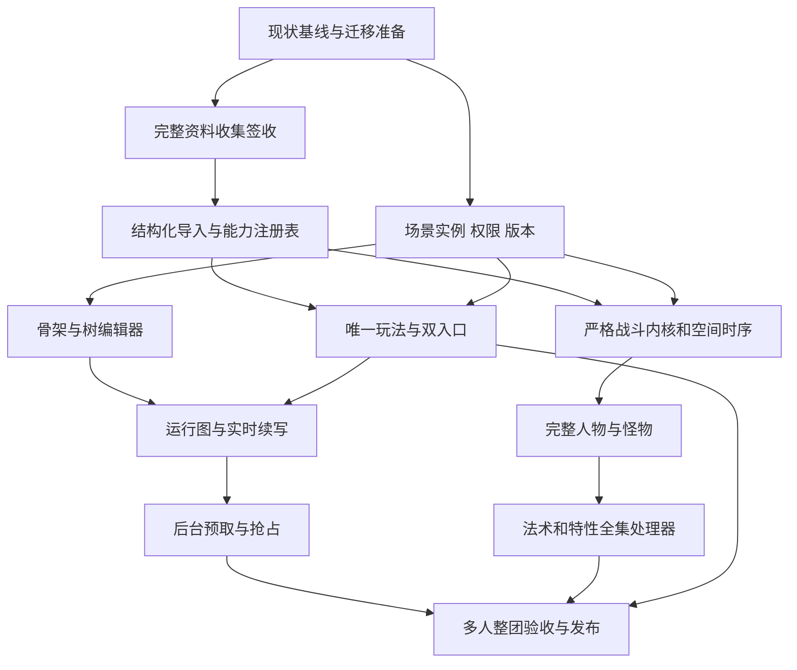

# 大版本实施任务与提交计划

设计版本 D1.0，2026-10-24。**本表为待实施计划；产品仍是 v0.6 基线。** 本轮已交付专业评审和设计，不把下列任务计作已完成。分队语音不在本次范围。

## 1. 本次设计交付与后续产品交付

| 交付 | 本轮状态 | 验收依据 |
|---|---|---|
| 重新设计玩法方向 | 完成 | direction.md |
| 三个专业方向评审与复审 | 完成 | review.md、最终修订记录 |
| 技术契约、任务依赖、验收用例 | 完成 | architecture.md、本表、acceptance.md |
| 设计小版本 commit、推送 GitHub | 由最终 Git 记录确认 | D0.1、D0.2、D1.0 三个提交及远端分支 |
| 产品功能开发、完整规则导入及全量验收 | 待实施 | 以下逐项任务 |
| 分队语音 | 本次排除 | 用户 2026-10-24 补充 |

后续产品大版本目标为 v1.0：唯一剧本 + AI DM、动态剧情树、完整所选基础资料及严格裁定、文字交流与行动分离、分队场景权限。下面版本号是计划标签，不是已发布版本。

## 2. 任务顺序与依赖

资料轨和场景基础设施轨可以独立开发；正式导入必须等待完整资料收集签收。动态生成开发阶段只能引用已支持的规则，不提前声称完整严格规则已发布。P10 的所有能力必须经 P08/P09 的统一执行层。

## 3. 小版本任务

### P00 / v0.7.0-pre：基线、迁移与可复现验证

- 记录现有测试结果、运行环境和源数据审计；安装项目声明的开发依赖。
- 为原始 JSON 与来源许可固定 LF，重新检出来源字节，保持 manifest 原 SHA-256。
- 分清已有失败与新增失败，登记 feature_automation、人物卡状态不一致和包外处理器问题。
- 制作旧房间、旧角色、旧剧本的脱敏迁移样本，包含进行中战斗、待确认提案和已领取奖励。
- 实施数据库 / 内容包备份、向前迁移标识与恢复演练；不能回滚代码后直接打开已经迁移的未知 schema。

主要位置：`.gitattributes`、`backend/data/`、`tests/test_compendium.py`、迁移工具与开发文档。验收：A01、A02、A30。提交建议：`fix(data): preserve source bytes and record migration baseline`。

### P01 / v0.7.0：完整资料收集，先签收再导入

- 固定 `ruleset_id=dnd5e-2014-srd5.1`；建立逐项官方范围清单，以官方章节 / 页码和预期条目为依据。社区 ID 用映射表连接，不把快照总数当官方全集结论。
- 清单覆盖职业、子职业、所有等级授予、特性与选择项、完整法术、18 技能，并收集其关联的种族、背景、专长、装备、物品、怪物、状态、动作、施法及战斗规则。
- 建立“官方章节 / 规则条目 → 原始资料 → 结构化记录”覆盖矩阵；纯说明文字也记录保留位置或无需结构化的理由。不能因组件、特殊能力或选择项没有独立表就漏验。
- 保存完整原始资料、来源版本、获取日期、哈希、文本范围、许可与项目声明。原始候选数据只读保留，中文标签与原文分开。
- 对照官方逐章检查遗漏、重复、字段缺损与文本截断；用覆盖清单登记“有来源 / 已映射 / 待补 / 不适用及原因”。已有生命领域勘误纳入比对。
- 输出 `source-coverage` 和差集报告：SRD 5.1、指定 Basic Rules 载体、PHB / 扩展分别列出；PHB 与扩展不进入本次公开基础包，不伪称已全部收录。
- 签收条件：选定范围没有待补正文或悬而未决条目；来源、正文和关系清单齐全。未签收不能执行 P02 正式初始化。

主要位置：`backend/data/source-manifest.json`、新增逐项覆盖清单与采集 / 审计工具、`docs/compendium-sources.md`、`NOTICE.md`。验收：A01–A04。提交建议：`data: finish and audit the selected 2014 source corpus`。

### P02 / v0.7.1：结构化暂存、原子初始化与统一注册表

- 正文和参数无损入暂存包；完整保存成长、前置、选择项、资源、法术职业归属、准备方式和子职业关系。
- 为派生条目附来源位置和显式勘误；无法解析的复杂规则保留原文并标记阻塞，禁止猜造字段。
- 建立唯一 ID、无悬空引用、每职业 1–20 级、18 技能、法术所有必要字段和双向关系校验。
- 安装版本化内容包：验证完成后原子启用；同包重复初始化幂等；任一失败回滚；规则版本随角色、剧本、房间冻结。
- 唯一能力注册表为目录、建角、菜单和 AI 工具提供支持状态。精确映射特性 ID 和处理器，清除分散前缀推断；包外能力单独声明或拒绝。
- 报告分为资料覆盖、构筑覆盖和执行覆盖。标签包含具体限制及测试证据，不能单凭 handler 存在计为完整支持。

主要位置：`backend/compendium.py`、`characters.py`、`abilities.py`、`data/`、导入器与测试。验收：A03–A06。提交建议：`feat(data): install versioned rules packages with one capability registry`。

### P03 / v0.7.2：场景实例、分队文字权限与版本

- 引入小队、场景实例、频道成员关系、世界实体和知识范围；迁移旧房间为单队单场景。
- 把 scene/combat/environment/DM 记忆及动作队列从房间全局移到场景；共享物品、NPC、剧情事实保留权威实体。
- 统一服务端读取、目标和行动权限，覆盖快照、WS、历史、导出、角色卡、提案和模型输入。
- 事件固化受众与权限代次；新增成员的历史权限默认不追溯。房主桌务身份不自动读秘密。
- 分离 storage、action、entity、graph 版本和 channel seq。闲聊不使动作或有效 DM 回复失效。
- 服务端游标绑定身份与频道；前端按 viewer/channel/epoch 清除旧日志及草稿引用。
- 调队与合队经过权限和场景状态校验；处理同时战斗、共同时间检查点及唯一物品冲突。
- 同场景也按响应受众知识交集构建 DM 输入；私语单独事件。处理共享实体的唯一遭遇归属、在途响应撤权与内部序号侧信道。

主要位置：`backend/app.py`、`store.py`、新增场景 / 频道 / 投影模块、`director.py`、`frontend/live-log.js`。验收：A07–A13、A27、A28、A33–A36。提交建议：`feat(session): isolate scenes channels knowledge and action revisions`。

### P04 / v0.7.3：唯一玩法、交流区与行动双入口

- 创建房间只选择剧本和桌务设置，移除双维模式入口；旧模式做兼容迁移，不留修改规则权限的旧 API 旁路。
- 交流区独立显示当前文字频道；行动区独立提供能力 / 法术 / 18 标准技能及自由描述。
- 两入口进入同一提案与执行管线；展示已知风险、目标、预计消耗和必要确认。
- 聊天与 DM 请求分离；NPC 对话通过行动提交。无风险互动不强迫检定，技能按钮不能强迫掷骰。
- 战斗非本人回合可聊天、查看和写草稿；动作提交由后端判断；反应以触发窗口处理。
- 移除任意“三次即兴检定后只能回按钮”的产品约束，重复尝试根据事实变化和规则资格判断。

主要位置：`backend/app.py`、`director.py`、`free_actions.py`、`frontend/index.html`、`app.js`、`styles.css`。验收：A08、A14–A17。提交建议：`feat(play): use one script DM flow with separate chat and action inputs`。

### P05 / v0.8.0：主线骨架、条件和树状编辑器

- 实现四类节点、声明式条件、里程碑、世界前提与可变化事实。
- frontier 保存完整续写契约；验证“可达结局或可续写末端”，不要求写完全部分支。
- 树导航显示分支、条件、主路径、引用和循环；节点详情编辑怪兽卡、对象和续写约束。
- 发布冻结内容版本；新增字段完整导入导出，旧剧本无损迁移。
- 编辑器 AI 草稿进入校验流程，不能直接覆盖正在运行的房间。

主要位置：`backend/schemas.py`、`studio.py`、`campaign.py`、`frontend/studio.*`。验收：A18、A19、A30。提交建议：`feat(studio): author sparse story graphs and continuation frontiers`。

### P06 / v0.8.1：房间扩展图、即时续写与等待恢复

- 统一作者图 + runtime_graph 解析；实现版本化 GraphPatch 验证、原子提交和来源。
- AI 可在约束下新增支线节点、NPC 与线索实体，复用冻结怪兽与规则数据；不能自行增加机械能力。
- 实时 DM 根据确认的自由行动提出新的后继，而非仅给固定按钮换说法。
- 未生成出口保存 pending transition；等待只影响该出口，不冻结当前可玩场景。
- 重试不重掷前置检定、不重复扣费、不自动转场；角色移动仍要匹配最新状态并显式提交。
- 规划器的隐藏信息与场景可见叙述分开；失败保留原场景并提供明确恢复路径。

主要位置：`backend/campaign.py`、`director.py`、`dm.py`、`store.py`、新增图验证器和续写服务。验收：A20–A23、A27。提交建议：`feat(story): extend room graphs with validated recoverable continuations`。

### P07 / v0.8.2：低优先级前瞻生成与抢占

- 持久任务队列、去重、预算、lease、超时、取消资格与重启恢复。
- 接近末端 / 偏离意图触发浅层预取，不递归铺满分支。
- 玩家实时操作优先；远程调用不持锁，背景取消后不能占住实时逻辑容量。
- 提交时检查场景、依赖、图版本、权限代次；过期结果丢弃并有界重试。
- 记录等待时长、作废率、命中率、取消耗时与 token 用量，调整预算。

主要位置：新增调度器、`backend/store.py`、`app.py`、`dm.py`。验收：A22、A24–A26。提交建议：`feat(dm): prefetch shallow branches with player-priority scheduling`。

### P08 / v0.9.0：严格战斗内核与文本空间

- 角色真实速度、距离 / 位置、触及、视线、掩护、体型与区域事实；不要求网格 UI，但机械事实可核查。
- 动作、附赠动作、移动、攻击次数、反应、机会攻击及触发窗口；先后顺序与资源扣除一致。
- 命中、豁免、优势劣势、暴击、抗性、免疫、临时 HP、倒地、死亡、治疗与稳定的完整顺序。
- 施法资格、成分 / 材料、准备 / 已知、法术位 / 契约位、仪式、施法时间限制、专注与持续触发。
- 范围包含友伤、遮挡与合法目标；替换简化速度和死亡处理房规。
- 骰点、事件与资源原子提交；可重放规则凭据，重复触发不重复扣费。
- 执行按规则步骤暂停 / 恢复，命中后选择和施法前反应保留触发时机；共享时钟驱动探索与跨场景持续效果。

主要位置：`backend/rules.py`、`abilities.py`、`free_actions.py`、`campaign.py`、`characters.py`、新增空间和反应模块。验收：A15–A17、A29、A37、A38、规则矩阵 R01–R08。提交建议：`feat(rules): enforce 2014 combat timing space and resource rules`。

### P09 / v0.9.1：完整基础构筑与预设怪兽

- 逐项接入所选范围的种族、背景、熟练、装备、专长及职业 / 子职业选择；预设角色遵循同一构筑校验。
- 职业 1–20 级授予与选择、准备 / 已知、资源和休息行为符合唯一注册表。
- 所选规则包括的可选规则明确独立标记；若提供多职业等选项必须完整验证其前提、成长和资源组合，不能悄悄接受未支持构筑。
- 怪兽卡引用版本化基础档案及其所有需要的动作、特性、资源、体型和抗性；自定义改动显式声明，不伪装为标准怪兽。
- 自定义剧情技能与标准规则能力区分，不在严格规则房间偷偷授予作者自定义数值。

主要位置：`characters.py`、`character_builds.py`、`heroes.py`、`compendium.py`、`campaign.py`、人物卡与工坊界面。验收：A05、A06、A29、R09–R11。提交建议：`feat(characters): complete selected core builds and faithful monster cards`。

### P10 / v0.9.2.x：法术与特性全集的逐项机械覆盖

P02 生成每个 content ID 的任务行：来源、原文段落、获得条件、处理器、前提、目标、代价、结算、持续 / 触发、失效、交互、测试和完成状态。按机制族实现共享执行器，再逐条核对具体例外。

| 子批次 | 机制与重点 | 核验要求 |
|---|---|---|
| .1 | 武器 / 法术攻击、单体伤害、额外伤害、治疗 | 命中、分伤害类型、暴击、升环、多个弹体 |
| .2 | 范围、豁免、持续区域、战场阻挡 | 友伤、进入 / 起止触发、重复豁免、遮蔽 |
| .3 | 状态、增益 / 减益、防护、驱散与反制 | 叠加、专注、到期、触发窗口、解除条件 |
| .4 | 移动、传送、飞行、水下及空间效果 | 速度、可达位置、坠落、距离与环境限制 |
| .5 | 幻术、魅惑、信息与社交效果 | 感知 / 豁免条件、知识受众、敌对解除 |
| .6 | 变形、召唤、控制单位、同伴 | 属性替换、控制权、回合、持续、死亡恢复 |
| .7 | 仪式、制作、消耗材料、复活、长期效果、特殊法术 | 时间、成本、实体持久化、特殊文本例外 |
| .8 | 十二职业全部特性与子职业特性、选择及被动触发 | 按实际获得等级和组合完整核对 |

某条目可归多族，但只维护一个权威状态，不能漏掉复杂句段。最终清单中的每一项都要通过正向、拒绝、资源与交互测试；以 P01 最终清单为准，不预设社区快照条目数就是最终真值。复杂效果按规则允许的情境裁量由 DM 提议结构化参数，机械后果仍由引擎执行。

每批可拆更小 patch 版本，每个完成版本独立 commit；未完成的批次不发布标签。正式 v1.0 不允许以 `reference` 或无说明拒绝代替本次所承诺范围的执行支持。确实需改变大版本范围时，必须显式记录差集和范围变更，不能把“覆盖常用能力”写成“全部完整”。

主要位置：统一能力注册表、效果执行器、内容关系映射、逐项覆盖报告及测试。验收：A29、R01–R12。提交建议：`feat(rules): complete <mechanic family> coverage for selected corpus`。

### P11 / v1.0.0：整团验收、迁移与发布

- 重跑现有回归与新增矩阵；真实浏览器验证桌面 / 手机、树编辑器、双入口、频道切换与重连。
- 用真实模型测试即兴剧情、前瞻子树、未命中续写、抢占和秘密隔离；记录模型配置、结果和预算。离线 stub 只验证协议，不能替代主持质量验收。
- 单人、六人同场、2+2 分队、不同场景同时战斗、合队、时限推进、重启恢复和唯一物品争用的整团场景。
- 每职业至少一条角色成长主线；每项规则处理器已有细粒度测试，不能只靠十二次跑团证明全集支持。
- 验证旧存档迁移不重置角色、不重发奖励、不重掷进行中的战斗；恢复演练通过。
- 更新 README、所有受影响设计 / 操作文档、来源与支持范围；提交完整验收报告及已知问题。
- 所有门禁通过后创建产品版本标签并推送 GitHub。部署到线上服务器为独立任务，本次推送不暗示已自动部署。

验收：A01–A38、R01–R12。提交建议：`release: validate script AI DM v1.0 and publish migration notes`。

## 4. 每个小版本的完成定义

1. 该版本所有任务有实际改动及对应验收证据；没有靠文档声明替代功能。
2. 运行相关既有回归和新增关键测试；记录失败及归因，不能跳过失败后标记完成。
3. 审阅差异、确认来源与存档兼容，写入变更记录。
4. 只暂存本版本明确文件，独立 commit；跨模块功能可以有中间提交，版本完成必须有可验证的最后提交。
5. 记录 commit、测试命令 / 结果和未解决问题。仅完成的版本可打标签；后续发现缺陷追加修复提交。
6. 设计阶段在 `codex/script-ai-dm-redesign` 分支推送。产品开发另建 `codex/` 工作分支，按验收推进；大版本完成推送，不强推或自动合并。

## 5. 工作量与停止条件

P00–P07 解决玩法和架构，P08–P10 是严格规则的大块工程，不能用现有 319 法术目录估算为简单数据导入。P01 与 P02 完成后，按实际缺失内容、共享执行器和例外数量再估算各批次工期；当前不承诺无依据的天数。

资料不齐不导入；场景权限未覆盖不开放分队；规则全集覆盖未通过不发布“完整严格规则”；真实模型体验未验收不标记 AI DM 质量达标。这些是对应版本的完成条件，均应在工作记录中保持待办，不能静默缩减目标。
